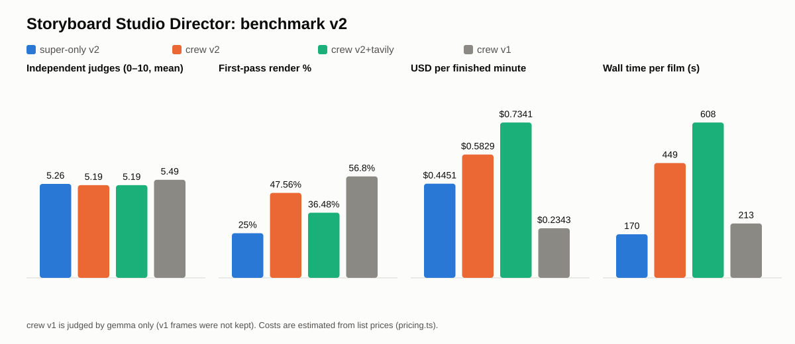

# Director benchmark v2: results

Generated 2026-10-15T03:15:18.628Z against `https://studio-production-049c.up.railway.app` · provider **nemotron** · eval commit `394a797` · 23 v2 runs · raw data: [eval/v2/runs.csv](eval/v2/runs.csv), [eval/v2/runs.jsonl](eval/v2/runs.jsonl). v1 results: [EVAL_RESULTS_V1.md](EVAL_RESULTS_V1.md).

Same 10 prompts and the same judge prompt as v1. Configs: **super-only v2** = every role on Nemotron Super, no critic · **crew v2** = Ultra plans, Super draws, the hybrid critic (a VLM looks, Nemotron Nano scores, D33) with the floor, Nano edits · **crew v2+tavily** = crew v2 plus research (only when the server has a Tavily key) · **crew v1** = the v1 rows, reused, not re-run (judged by gemma only).

**Independent judges** (blind to config, both different from the critic and from every crew model, checked per run): `google/gemma-3-27b-it` and `moonshotai/Kimi-K3`. Each scores every final frame 0–10 against its shot description. The headline judge is `google/gemma-3-27b-it`, the v1 judge, so v2 compares with v1 like for like; the second judge is reported in its own column and its own paired table. "Judge (mean)" in the tables is the mean of both. **Critic uplift** is judged independently too: for every shot where a revision replaced the first version, both judges score the pre-revision snapshot and the accepted one, and the uplift is the mean (after − before).

## Targets (SPEC v2 WP7)

| Target | Goal | Measured | |
|---|---|---|---|
| Judge mean, crew v2 (gemma-3-27b-it, the v1 judge; crew v1 = 5.49) | ≥ 6.5 | 6.17 | ❌ missed |
| Second judge, crew v2 (Kimi-K3, reported separately) | — | 4.21 | for information |
| Crew v2 wins vs super-only v2 (paired, gemma-3-27b-it, ±0.25 = tie) | ≥ 8/10 | 5/7 | ❌ missed |
| Critic uplift, independently judged | ≥ +0.5 | +0.44 | ❌ missed |
| USD per finished minute, crew v2 | ≤ $0.40 | $0.583 | ❌ missed |

## By config

| Config | Runs (done) | Judge (mean) |  Judge gemma-3-27b-it | Judge Kimi-K3 | First-pass % | Repairs / shot | Critic self-score | Uplift (judged) [shots] | Gate failures | Below floor | Wall s | Tokens / run | USD total | USD / finished min |
|---|---|---|---|---|---|---|---|---|---|---|---|---|---|---|
| super-only v2 | 8 (8) | 5.26 |  5.98 | 4.55 | 25 | 1.85 | — | — [0] | 6 | 0 | 170.49 | 60,467 | $0.328 | $0.445 |
| crew v2 | 8 (7) | 5.19 |  6.17 | 4.21 | 47.56 | 1.71 | 4.91 → 5.48 | +0.44 [9] | 8 | 25 | 449.02 | 245,818 | $1.282 | $0.583 |
| crew v2+tavily | 7 (5) | 5.19 |  6.13 | 4.25 | 36.48 | 2.38 | 4.76 → 5.44 | +0.42 [12] | 11 | 21 | 607.5 | 334,146 | $1.561 | $0.734 |
| crew v1 | 10 (10) | 5.49 |  5.49 | — | 56.8 | 1.53 | 6.92 → 7.07 | — [0] | 0 | 0 | 212.68 | 124,066 | $0.864 | $0.234 |



## Spread, failures, time and cost

Per config and judge: n = runs that judge scored, mean ± sample SD and the range of the per-run means. A failed run is any run whose status is not `done`.

| Config | Judge | n | Mean | SD | Min–max |
|---|---|---|---|---|---|
| super-only v2 | gemma-3-27b-it (headline) | 8 | 5.98 | 1.58 | 4–8 |
| super-only v2 | Kimi-K3 | 8 | 4.55 | 1.52 | 2.4–7 |
| crew v2 | gemma-3-27b-it (headline) | 7 | 6.17 | 0.62 | 5–6.75 |
| crew v2 | Kimi-K3 | 7 | 4.21 | 0.82 | 2.5–4.86 |
| crew v2+tavily | gemma-3-27b-it (headline) | 6 | 6.13 | 0.49 | 5.6–6.8 |
| crew v2+tavily | Kimi-K3 | 6 | 4.25 | 0.43 | 3.5–4.71 |
| crew v1 | gemma-3-27b-it (headline) | 10 | 5.49 | 0.89 | 4–7 |
| crew v1 | Kimi-K3 | 0 | — | — | — |

| Config | Runs | Done | Failed (status) | Wall s mean | Wall s total | USD total |
|---|---|---|---|---|---|---|
| super-only v2 | 8 | 8 | 0 | 170.49 | 1363.91 | $0.328 |
| crew v2 | 8 | 7 | 1 (vi-ao-dai: failed) | 449.02 | 3592.18 | $1.282 |
| crew v2+tavily | 7 | 5 | 2 (en-robot-garden: failed; vi-ao-dai: budget_exceeded) | 607.5 | 4252.48 | $1.561 |
| crew v1 | 10 | 10 | 0 | 212.68 | 2126.79 | $0.864 |

## Reproduce

```bash
npm run director:bench -- --base https://studio-production-049c.up.railway.app --eval-commit 394a79793e047b5227325ec1eda8361418a6ae21 --configs A,B,C --limit 10
```

The bench refuses to start unless the server reports the eval commit, stops if it changes, and on resume keeps only rows made on that commit.

## Paired: crew v2 vs super-only v2 (judge gemma-3-27b-it)

crew v2 − super-only v2 on the same prompt: mean **+0.34**; crew v2 is better on **5**, worse on **2**, and ties (±0.25) on **0** of 7 prompts. 

| Prompt | super-only v2 | crew v2 | Δ |
|---|---|---|---|
| en-lighthouse | 4.2 | 5.8 | +1.6 |
| en-robot-garden | 8 | 6.17 | -1.83 |
| en-paper-boat | 4 | 5 | +1 |
| en-moon-bakery | 5 | 6.57 | +1.57 |
| vi-trau-vang | 5.6 | 6.2 | +0.6 |
| vi-cho-noi | 8 | 6.71 | -1.29 |
| ja-umbrella | 6 | 6.75 | +0.75 |

## Paired: crew v2 vs super-only v2 (second judge Kimi-K3, reported separately)

crew v2 − super-only v2 on the same prompt: mean **-0.28**; crew v2 is better on **2**, worse on **3**, and ties (±0.25) on **2** of 7 prompts. 

| Prompt | super-only v2 | crew v2 | Δ |
|---|---|---|---|
| en-lighthouse | 2.4 | 4 | +1.6 |
| en-robot-garden | 7 | 4.83 | -2.17 |
| en-paper-boat | 4 | 2.5 | -1.5 |
| en-moon-bakery | 3 | 4.57 | +1.57 |
| vi-trau-vang | 4 | 4.2 | +0.2 |
| vi-cho-noi | 5 | 4.86 | -0.14 |
| ja-umbrella | 6 | 4.5 | -1.5 |

## Paired: crew v2 vs crew v1 (judge gemma-3-27b-it only, as in v1)

crew v2 − crew v1 on the same prompt: mean **+0.64**; crew v2 is better on **4**, worse on **2**, and ties (±0.25) on **1** of 7 prompts. Same prompts, same judge, same judge prompt; v1 frames were not kept, so the second judge can't score v1.

| Prompt | crew v1 | crew v2 | Δ |
|---|---|---|---|
| en-lighthouse | 5.6 | 5.8 | +0.2 |
| en-robot-garden | 6.67 | 6.17 | -0.5 |
| en-paper-boat | 4 | 5 | +1 |
| en-moon-bakery | 5.25 | 6.57 | +1.32 |
| vi-trau-vang | 7 | 6.2 | -0.8 |
| vi-cho-noi | 4.71 | 6.71 | +2 |
| ja-umbrella | 5.5 | 6.75 | +1.25 |

## Per run

| Version | Config | Prompt | Status | Shots | Judge |  Judge gemma-3-27b-it | Judge Kimi-K3 | First-pass % | Repairs/shot | Critic self | Uplift [shots] | Gates | Wall s | USD |
|---|---|---|---|---|---|---|---|---|---|---|---|---|---|---|
| v2 | super-only v2 | en-lighthouse | done | 5/5 | 3.3 |  4.2 | 2.4 | 20 | 2.4 | — → — | — [0] | 4 | 170.16 | $0.0642 |
| v2 | crew v2 | en-lighthouse | done | 5/5 | 4.9 |  5.8 | 4 | 0 | 4 | 4.4 → 4.4 | — [0] | 3 | 662.54 | $0.2475 |
| v2 | crew v2+tavily | en-lighthouse | done | 5/5 | 5.6 |  6.8 | 4.4 | 40 | 5.2 | 2.8 → 3.4 | +2.5 [1] | 3 | 778.6 | $0.3028 |
| v2 | super-only v2 | en-robot-garden | done | 1/1 | 7.5 |  8 | 7 | 0 | 3 | — → — | — [0] | 1 | 244.48 | $0.0517 |
| v2 | crew v2 | en-robot-garden | done | 6/6 | 5.5 |  6.17 | 4.83 | 33.33 | 4.5 | 4.83 → 4.83 | — [0] | 4 | 370.05 | $0.1788 |
| v2 | crew v2+tavily | en-robot-garden | failed | 0/6 | — |  — | — | 0 | 0 | — → — | — [0] | 0 | 487.46 | $0.1244 |
| v2 | super-only v2 | en-paper-boat | done | 1/1 | 4 |  4 | 4 | 0 | 3 | — → — | — [0] | 1 | 172.99 | $0.0366 |
| v2 | crew v2 | en-paper-boat | done | 4/4 | 3.75 |  5 | 2.5 | 50 | 2 | 2.5 → 3.5 | +0.75 [2] | 1 | 572.89 | $0.2016 |
| v2 | crew v2+tavily | en-paper-boat | done | 4/4 | 5.38 |  6.25 | 4.5 | 50 | 1.75 | 5.75 → 6.75 | +0.5 [1] | 1 | 632.71 | $0.1920 |
| v2 | super-only v2 | en-moon-bakery | done | 1/1 | 4 |  5 | 3 | 0 | 2 | — → — | — [0] | 0 | 186.26 | $0.0403 |
| v2 | crew v2 | en-moon-bakery | done | 7/7 | 5.57 |  6.57 | 4.57 | 100 | 0.14 | 5.57 → 6.86 | +0.33 [3] | 0 | 378.48 | $0.1427 |
| v2 | crew v2+tavily | en-moon-bakery | done | 8/8 | 4.94 |  5.88 | 4 | 12.5 | 4 | 4.5 → 5.25 | +0.5 [3] | 4 | 634.85 | $0.2806 |
| v2 | super-only v2 | vi-ao-dai | done | 1/1 | 6 |  7 | 5 | 100 | 0 | — → — | — [0] | 0 | 159.39 | $0.0320 |
| v2 | crew v2 | vi-ao-dai | failed | 0/6 | — |  — | — | 0 | 0 | — → — | — [0] | 0 | 423.28 | $0.1071 |
| v2 | crew v2+tavily | vi-ao-dai | budget_exceeded | 6/6 | 4.59 |  5.67 | 3.5 | 50 | 1.17 | 4.83 → 4.83 | — [0] | 1 | 859.76 | $0.2537 |
| v2 | super-only v2 | vi-trau-vang | done | 5/5 | 4.8 |  5.6 | 4 | 80 | 0.4 | — → — | — [0] | 0 | 168.67 | $0.0451 |
| v2 | crew v2 | vi-trau-vang | done | 5/5 | 5.2 |  6.2 | 4.2 | 40 | 1.6 | 5.2 → 5.8 | +1 [1] | 0 | 355.12 | $0.1399 |
| v2 | crew v2+tavily | vi-trau-vang | done | 5/5 | 5 |  5.6 | 4.4 | 60 | 1 | 5.4 → 6 | -0.5 [3] | 0 | 307.1 | $0.1104 |
| v2 | super-only v2 | vi-cho-noi | done | 1/1 | 6.5 |  8 | 5 | 0 | 1 | — → — | — [0] | 0 | 108.08 | $0.0242 |
| v2 | crew v2 | vi-cho-noi | done | 7/7 | 5.79 |  6.71 | 4.86 | 57.14 | 1.43 | 6.14 → 6.71 | +0 [2] | 0 | 256.36 | $0.1192 |
| v2 | crew v2+tavily | vi-cho-noi | done | 7/7 | 5.64 |  6.57 | 4.71 | 42.86 | 3.57 | 5.29 → 6.43 | +0.5 [4] | 2 | 552 | $0.2967 |
| v2 | super-only v2 | ja-umbrella | done | 1/1 | 6 |  6 | 6 | 0 | 3 | — → — | — [0] | 0 | 153.88 | $0.0343 |
| v2 | crew v2 | ja-umbrella | done | 4/4 | 5.63 |  6.75 | 4.5 | 100 | 0 | 5.75 → 6.25 | +0.5 [1] | 0 | 573.46 | $0.1448 |
| v1 | crew v1 | en-lighthouse | done | 5/5 | 5.6 |  5.6 | — | 40 | 3.6 | 5 → 5 | — [0] | 0 | 253.91 | $0.1251 |
| v1 | crew v1 | en-robot-garden | done | 6/6 | 6.67 |  6.67 | — | 0 | 7 | 3.33 → 3.83 | — [0] | 0 | 484.53 | $0.2288 |
| v1 | crew v1 | en-paper-boat | done | 4/4 | 4 |  4 | — | 75 | 0.75 | 7.75 → 7.75 | — [0] | 0 | 152.01 | $0.0520 |
| v1 | crew v1 | en-moon-bakery | done | 8/8 | 5.25 |  5.25 | — | 62.5 | 0.75 | 7.5 → 7.75 | — [0] | 0 | 190.91 | $0.0815 |
| v1 | crew v1 | vi-ao-dai | done | 6/6 | 5.83 |  5.83 | — | 83.33 | 0.33 | 7.67 → 7.83 | — [0] | 0 | 141.13 | $0.0448 |
| v1 | crew v1 | vi-trau-vang | done | 5/5 | 7 |  7 | — | 100 | 0 | 7 → 7.6 | — [0] | 0 | 121.69 | $0.0455 |
| v1 | crew v1 | vi-cho-noi | done | 7/7 | 4.71 |  4.71 | — | 57.14 | 0.43 | 7.86 → 7.86 | — [0] | 0 | 177.64 | $0.0591 |
| v1 | crew v1 | ja-umbrella | done | 4/4 | 5.5 |  5.5 | — | 100 | 0 | 7.75 → 7.75 | — [0] | 0 | 132.25 | $0.0380 |
| v1 | crew v1 | ja-tanuki | done | 6/6 | 4.83 |  4.83 | — | 16.67 | 1 | 7.83 → 7.83 | — [0] | 0 | 177.3 | $0.0698 |
| v1 | crew v1 | ja-sakura | done | 8/9 | 5.5 |  5.5 | — | 33.33 | 1.44 | 7.5 → 7.5 | — [0] | 0 | 295.42 | $0.1191 |

## Reading the results (honest)

_To be written by a person after the run, from the numbers above only. If a target is missed, say so; the prompts were not tuned on._

Notes: judge calls are billed in the spend ledger but excluded from the per-run USD. USD uses the price table in `src/lib/providers/pricing.ts`. One run per prompt and config, so read small differences as noise.
