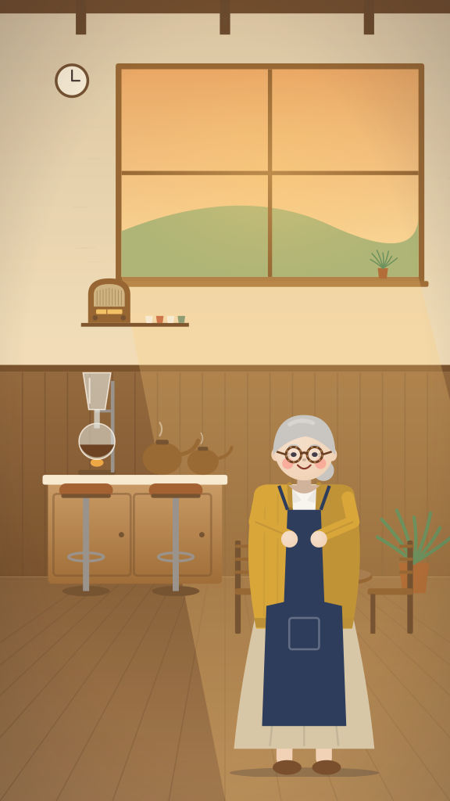
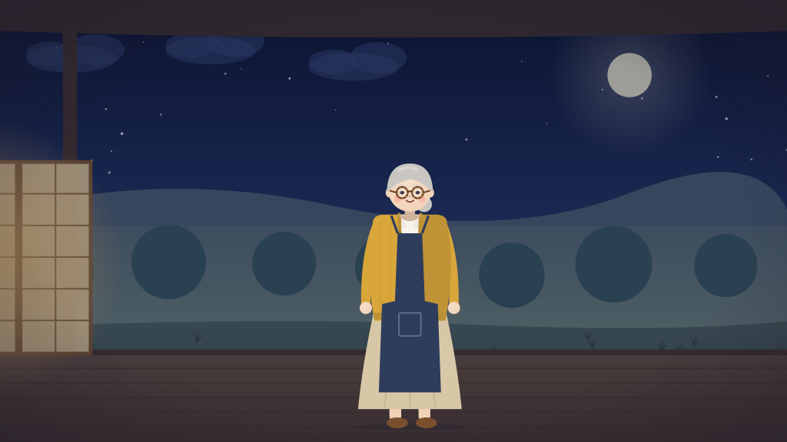

# STATUS: Storyboard Studio Director

## v2 (SPEC_V2.md): execution plan

_Started 2026-10-09 (ICT). Branch `claude/gifted-cannon-1nhl2s` → small PRs to `main`. v1 status is kept below, unchanged._

**Order** (P0 first, then P1 in the spec's slip order):

| # | WP | What | Target |
|---|---|---|---|
| 1 | WP2 | Identity: `package.json`, app metadata + OG image, README restructure (prior work clearly separated), honest Tavily wording, `OWNER_GITHUB_ABOUT.md` | M1 |
| 2 | WP1 | Runs survive the browser (detached run + `GET …/runs/:runId/events` replay-then-tail SSE + client reconnect, wall-time watchdog, D26) · unlock copy + showcase link + contact · 3 one-click sample stories (EN/VI/JA) · showcase "Replay the real run" (10×) · `GET /api/health` + daily GitHub Actions health cron · capacity review | M1 |
| 3 | WP3 | Researcher: Nano yes/no detection with a reason, cited visual notes that flow into the Bible, Research card + per-shot citation chips. **Without a key by M1: every user-facing claim says "optional, not enabled in the demo"** | M1 |
| 4 | WP9 (tooling only) | `JUDGE_ACCESS.md` + `scripts/judge-access-pdf.ts` (passcode from env at export, git-ignored output) | M1 (the judge path depends on it) |
| 5 | WP4 | Gates (readable set, close-up framing, empty frame, near-duplicate) → acting (poses, expressions, blinks, lip-sync) → Piper voices → vision critic (+ floor) → shot variety → score bed | M2 |
| 6 | WP5 | `Series` model, save/pick, host identity hash tests; Hidamari pilot (needs O4) | M2 |
| 7 | WP6 | Landing (hero film, 2 buttons, samples), run view, finished view, JA strings, a11y | M2 |
| 8 | WP7 | Bench v2 (super-only v2, crew v2, crew v2 + Tavily if live), two judges ≠ critic | M2 |
| 9 | WP8/WP9 | Video v2 + YOUTUBE.md + thumbnail; DEVPOST_SUBMISSION_V2.md (9 long feedback answers); HANDOFF_V2.md | M3 |
| 10 | WP10 | Nebius Serverless bench, only with O5 | P2 |

**Risks**
- **Live access from this session.** This cloud session has no `NEBIUS_API_KEY`/`TAVILY_API_KEY`/passcode, and environment secrets added now only reach a *new* session. The hosted service has the Nebius key. Plan: run live work (hosted verification, bench, showcase) **against the hosted demo**; WP1's detached runs make the sandbox's stream cuts (v1 D9/D23) harmless. The judge/probe calls need a server-side path or a key here (see B5).
- **Tavily key** (B2/O1): if it doesn't arrive by M1, the fallback ships (claims removed, code kept).
- **Vision critic**: no Nemotron VLM on Token Factory (D15). SPEC v2 §WP4.4 allows a labelled non-NVIDIA open VLM as critic; the Nemotron crew keeps every role it holds today. The eval judges must then differ from the critic.
- **Scope vs. 2 weeks**: WP4 is large. If M2 slips: gates → acting → voices → critic → variety, then series, then UI. Video + Devpost (M3) never slip.
- **Railway deploy source** is still the v1 branch `claude/gracious-ritchie-a739ft`. Deploys switch it to `main` after each merged milestone PR (reversible).

**What I need from the owner** (details and click-by-click steps in BLOCKERS.md): O4 Hidamari narration WAVs (line list: [eval/pilot-lines.md](eval/pilot-lines.md)) and the look · O7 GitHub social preview (after the re-shot hero) · O6 later. Resolved 2026-10-10: O1 Tavily key on Railway, O2 Token Factory balance $23.06 with no expiry, O3 Railway Hobby plan with a $40 hard limit.

**Spend (v2)**: v1 total **$3.23** (ledger). v2 cap **$14** (raised from $10 by the owner on 2026-10-11); stop line `SPEND_ALERT_USD` = 3.23 + 14 = **17.23**. Token Factory balance reported by the owner: _pending (O2)_.

### v2 log
- 2026-10-13: **Take day.** Kite take 1 (`cmv5x8pqj00012aqtw2ld6ad3`, $0.215): the approved cast with the engine's starred kite (hashes match), 59.1 s; NOT a candidate — 2 shots fail a measured gate, shots 7 (face cut off) and 11 ("golden dusk" vs the golden-lit beach) off-plan. Bánh chưng take 1 (`cmv5xjlgc005t2aqt3v8r4bh8`, $0.20): zero gate failures, but shots 10–11 off-plan (night lighting for dawn shots — an engine bug) and 43.2 s < 45 s. Fixes in D79 (dawn = day, "dark" ≠ night; `minFilmSec` holds; per-take evidence). Contact sheets + credit frames in [evidence/takes/](evidence/takes/).
- 2026-10-13: **Take day, round 2.** #40 merged and live (`450bae5`). Tegami take 1 (`cmv5ykmeb00012akxlfjmz3qi`, $0.119, 46.8 s, approved cast hashes match): NOT a candidate — 2 shots fail a measured gate, shot 7 off-plan, shot 4 critic 3; by eye, shots 2–6 are pushed off the 9:16 canvas by an engine camera bug (D81, fixed). Bánh chưng take 1's last shot had no table (D80: the engine now draws it). Kite take 2 waits for the owner's call on "golden dusk"; bánh chưng take 2 and tegami take 2 (the last of each) run after the D80/D81 fix is live.
- 2026-10-13: **Tegami take 2** (`cmv5zd43a00012aqjvcwijeov`, $0.082, 46.8 s, on `5d233fa` with D80/D81 live; cast hashes match): every shot fills the 9:16 frame (D81 confirmed). NOT a candidate — 1 shot fails a measured gate: shot 5 (over-the-shoulder read) has the open envelope held over the gentleman's mouth (59% of the head covered) after 4 repair attempts, off-plan, critic 3. Critic scores 8/7/4/9/3/7/6. Recognition: envelope not recognised ("tag", "notebook page") → owner + QC override. This was tegami's last allowed take: owner decision needed.
- 2026-10-13: **Owner + QC final decisions (D82–D84): all 3 showcase films published by end of 10-14, no more design rounds.** Golden dusk on a golden-lit set = golden hour (D82); a held prop over a face moves to the chest (D83); single-shot redo for a take that fails 1–2 shots, ≤ 2 redos per shot (D84); bánh chưng last line "Trên bàn là…"; tegami take 3 as a one-off exception. Order: kite take 2 → bánh chưng take 2 → tegami take 3; per film: contact sheet + credit frame + checklist → QC signs → owner signs → publish; then the hero/README GIF/OG image swap to the kite.
- 2026-10-13: **Kite take 2** (`cmv6fvwbe00012ao49z3wfu27`, project `cmv6fvw1b00002ao4yql23ywc`, $0.189, 58.5 s, on `926c623`; cast hashes match incl. the engine's `#kite--starred` fc9e9c0f0783; all 4 kite drawings recognised "red kite"): **0 measured gate failures**; shot 11 on-plan (D82). Only blocker: shot 4 (kitchen) off-plan ("no lace curtains / morning light"). Critic below 4: shot 9 (3). Redo of shot 4 refused by the demo session check (the take ran in another operator session) → the route lets an operator's redo cross sessions (D84 addendum, owner review: it touches the demo gate). The take's project expires 24 h after creation (~2026-10-14 08:47 UTC).
- 2026-10-13: **Bánh chưng take 2** (`cmv6g4rbd005g2ao4tni0bq5r`, project `cmv6g4r9e005f2ao49hjkdcry`, $0.162, on `926c623`; the table under the bánh chưng in shot 11 (D80) and the day-lit dawn shots (D79) both landed): NOT a candidate — shot 2 fails a measured gate (too like shot 1/3), shots 2 and 4 off-plan, and the film is 41.4 s < 45 s (D79's projection missed the transitions: fixed in D85). Next: redo shots 2 + 4 on this take (with D85 the redo also brings the film to its floor). Recognition: #banh-chung not recognised ("green grid pattern") → owner + QC override.
- 2026-10-13: **Tegami take 3** (one-off exception; `cmv6gh0pd00a52ao42yvsog59`, project `cmv6gh0ay00a42ao45fxmyd5c`, $0.106, 44.9 s, on `926c623`): **0 measured gate failures** (no covered face: D83). Only blocker: shot 6 off-plan ("night scene with bright lighting" — the plan says afternoon and the frame is day-lit). Critic 8/7/6/5/5/3/7. Next: redo shot 6. **All three films are one redo away from a candidate** (kite 4, bánh chưng 2+4, tegami 6); the redos need the operator's cross-session redo (owner review: demo gate). Projects expire 24 h after creation (kite ~10-14 08:47, bánh chưng ~08:56, tegami ~09:05 UTC).
- 2026-10-12 (night): **Casts approved (D78)** — kite `cmv5ck21700012aphuliu0dto` (starred = the patched red kite + a gold star, engine-drawn, `fc9e9c0f0783`, shown to the owner alone), bánh chưng `cmv5ckxxt00132aphiklvzwwj` (by eye; table in the front room for the last shot), tegami `cmv5blc2p00012apju1cnaj3g` (by eye; now `v2-tegami`, a 9:16 Short in the showcase pipeline). QC blocker fixed: a 9:16 Short runs 30–60 s (tegami 43.4 s), 16:9 films keep 45–90 s. Full takes on 10-13 (UTC) in the order kite → bánh chưng → tegami, max 2 each.
- 2026-10-12 (evening): **Previews on the D77 engine** (`89b5c10`, after #37; $0.15): [evidence/preview-2026-10-12-r5/](evidence/preview-2026-10-12-r5/). **Kite** (run `cmv5ck21700012aphuliu0dto`, $0.03): the approved intact kite (#kite `fc34c57b116c`) with the engine's torn (#kite--torn `2e52e121e981`) and patched (#kite--patched `c47c749f99e4`) states and the round-4 starred drawing (`94cf223f4c4d`); all four recognised, torn and patched with their change named by the viewer; beach and kitchen sets. **Bánh chưng** (run `cmv5ckxxt00132aphiklvzwwj`, $0.04): one look, #banh-chung `82007704a615` (recognition carried: NOT recognised, "green grid pattern" → owner + QC by eye); courtyard night/day, front room, rooftops. **Tegami** (run `cmv5cm5ua001z2aphobeyba8v`, $0.08, the anatomy fix in): the envelope still NOT recognised ("wooden door", "a house shape": the sealed back drawn as a pentagon); its kissaten is plainer than the first preview's (run `cmv5blc2p00012apju1cnaj3g`). Waiting on the owner's approval of the three casts before the 10-13 takes.
- 2026-10-12 (evening): **Owner decisions (D77)** — fūrin dropped, the Japanese showcase is PILOT01 tegami; the kite is the hero film, its torn/patched states drawn by the engine on the approved intact kite (generic `tear`/`patch` state transforms); bánh chưng keeps one look (the round-4 base); the recognition gate becomes a judgement the owner + QC may sign past on the checklist (`Recognition override`), measured gates stay. **Tegami cast-only preview** ($0.07, plus $0.03 for a first attempt interrupted by the #36 redeploy, both in the ledger): [evidence/preview-2026-10-12-tegami/](evidence/preview-2026-10-12-tegami/): kissaten and river path read well; the envelope was NOT recognised ("house icon", "a tag") — partly a bug (the planner's own anatomy with the category "prop" was kept; fixed). **New dates:** 10-13 full takes (kite, tegami, bánh chưng, max 2 each, `--cast-from` the approved previews); end of 10-14 hard stop (whatever passes QC is published and used); 10-15 bench (6 M daily budget through 10-15); 10-16/17 video v2 + Devpost; Shorts in parallel when the budget allows.
- 2026-10-12: **Cast-only previews, round 4** (kite + bánh chưng, `2e379c2`, after #35; $0.25): [evidence/preview-2026-10-12-r4/](evidence/preview-2026-10-12-r4/). **Kite**: intact and starred recognised; torn and patched NOT (the viewer says "kite" but never names the hole or the patch; the last torn redraw lost the kite). **Bánh chưng**: plan now completes; NOT recognised in any state ("window", "grid pattern", "plaid napkin"), although the drawing matches the owner's targets by eye. Sets fine for both. Two engine fixes (D76: keep the round's best drawing; a viewer's name with the category overrules Nano's look-alike flag). Waiting on the owner: fūrin → tegami decision, and how to treat kite torn/patched and bánh chưng.
- 2026-10-12: **Cast-only previews, round 3** (`707e6c9`, after #34; $0.22): [evidence/preview-2026-10-12-r3/](evidence/preview-2026-10-12-r3/). **Fūrin NOT recognised** (time-box reached: 7 redraws over 9 looks, 0 of 5 anatomy parts ever seen; the one "pass", "a white flower on a stick", was a false positive) → owner decision on PILOT01 tegami. **Kite**: recognised by name but drawn as a small diamond under a long string (torn/patched unreadable; "patched" was never drawn and passed falsely). **Bánh chưng**: run failed at the plan (Ultra's reply cut off at the 8 k token cap, 3 times). Fixes in D75 (claims verified against the viewer's words, stand-in states can't pass, key object fills its viewBox, no string in a flying object's symbol, plan budget 14 k); then kite and bánh chưng previewed again (round 4).
- 2026-10-12: **Hero-object round 3** (D74, owner decision after #33): key object recognised by visible features (Ultra writes its anatomy before the Cast draws; Nano reports category/parts/look-alike/state change; the engine applies the pass rule), 4 real redraws (an engine-rejected redraw is retried once with its problem, no look spent), every state symbol shows something alone (cause of round 1's blank bánh chưng states: the whole-library placeholder fallback had no state symbols), states pass only when their visible change is named, kit streets/markets paved with stone. Then the 3 previews again (round 3).
- 2026-10-12: **Cast-only previews, round 2** (`ac35974`, after #33; $0.24): [evidence/preview-2026-10-12-r2/](evidence/preview-2026-10-12-r2/). Libraries assembled cleanly (no placeholders). **Kite** recognised in all 3 states (intact, torn, starred) and the states now differ clearly; beach lit for day, kitchen — candidate for approval (run `cmv4ziiui00012ao56c9xawx9`). **Bánh chưng** NOT recognised ("window", "calendar page"; "cooked" passed as "a green-framed box", a lenient match), sets right (night courtyard, front room, night rooftops). **Fūrin** NOT recognised ("crossed sticks on oval", "four matchsticks"), sets right (veranda day/night, festival street at dusk, tea room).
- 2026-10-12: **Cast-only previews** on the hosted demo (`e52769f`, after #32; $0.23 for the three): one sheet per film (every hero-prop state and every set, alone, with a hash per symbol) sent to the owner; evidence in [evidence/preview-2026-10-12/](evidence/preview-2026-10-12/). The recognition gate worked: **kite** recognised in all 4 states (but the states differ only faintly, and its beach was lit at dusk for morning shots); **fūrin** NOT recognised ("brown bottle with green cap", "a skewer with meat") after 2 redraws each; **bánh chưng** NOT recognised ("window with cross", "gift box", "firework box") and its whole library fell back to placeholders (one malformed symbol). None is ready for approval; two engine fixes in the reuse PR (library salvage, dusk-set day variant), then a re-preview. **Reuse PR** (D73): a full take runs on the approved preview's cast verbatim (`castFromRun`), hashes per symbol in the sheet and the take's log. Daily budget 6 M kept through 10-15 (revert moved to 10-16 00:05 UTC, B11). Schedule: full takes after the previews are approved, Shorts and bench one day later than planned.
- 2026-10-12: **Engine PR after QC of the re-shoot** (D71, D72): time of day judged in buckets (morning vs afternoon is not off-plan; day/dusk/night still block); hero-prop **recognition gate** (each state rendered alone, named by the vision model, checked by Nano, redrawn by the Cast on a miss, ≤ 2; blocks publishing when not recognised or not checked); **prop states** (intact → torn → mended…, one symbol per state, each shot uses its state); the **kite string** from the holder's hand; the engine **scales undersized props** before any repair, sends the **night drawing order** with the first draw, **unwraps `<svg>`** instead of losing the shot; an insert's span is measured on the object's **body**, not its string. Cast-only **preview** (`npm run director:preview`) for by-eye approval before full takes. No live spend yet.
- 2026-10-12: **Showcase re-shoot (owner plan 2026-10-11)** on the hosted demo (`d15ecbc`, operator cap 800 k live, daily budget 6 M; research on; 2 takes per film; $1.49 for the six takes, v2 spend ≈ $5.10 of $14): **no take passed the measured gates; nothing published, the hero/README GIF/OG are unchanged.** Contact sheets + one credit frame per film sent to the owner for QC. Evidence: [evidence/reshoot-2026-10-12/](evidence/reshoot-2026-10-12/).
  | Film | Take | Rendered | Gate failures | Wrong time/place | Length | Critic mean (min) | Cost |
  |---|---|---|---|---|---|---|---|
  | fūrin | 1 | 11/11 | 6 | 1, 2, 4 | 64.8 s | 5.0 (3) | $0.278 |
  | fūrin | **2** (better) | 10/11 | 7 | — | 70.6 s | 5.9 (4) | $0.255 |
  | kite | 1 | 11/11 | 5 | 2, 4, 5, 11 | 59.6 s | 4.9 (2) | $0.369 |
  | kite | **2** (better) | 11/11 | **0** | 2, 8 (time only) | 53.6 s | 6.2 (3) | $0.188 |
  | bánh chưng | 1 | 11/11 | 3 | 10, 11 | 40.6 s | 6.1 (3) | $0.187 |
  | bánh chưng | **2** (better) | 11/11 | 4 | 2, 3 | 49.8 s | 6.5 (3) | $0.209 |

  What still fails: medium-shot key props drawn at 0.05–0.3 % of the frame (needs 0.40 %), night frames too dark for the figures, an Artist `<svg>` root that loses a shot, and the VLM reading one warm beach sky as "late afternoon" where the plan says morning (kite 2/8). Owner question raised: should morning-vs-afternoon (not day-vs-night) block?
- 2026-10-11: **Owner decisions** (D69): operator per-run cap 800 k (judges stay at 500 k, `/api/health` shows both), revised publish gate (measured gates block; critic mean ≥ 5.5 and no shot < 4; the action verdict moves to the by-eye checklist; owner + QC may approve past critic scores, never past a measured gate), camera-move rule in the critic, hero props drawn in detail and ≥ 25 % of an insert, a readable kneel. Spend cap $14; day budget 6 M for 10-12 → 14. WAVs OK as they are. Schedule: 10-12 re-shoot fūrin (hero candidate), kite, bánh chưng, up to 2 takes each · 10-13 Hidamari Shorts · 10-14 frozen-commit bench.
- 2026-10-11: **Fūrin run 4** (`3c76aa7`, $0.255): 10/11 shots, 7 off-plan, not publishable; best by eye so far (kit figures, the three briefed sets). The daytime opening was still drawn at night ("Summer day" was not read as day) → fixed (D68). Live runs stopped for today; v2 spend ≈ $3.61 of $10. [Contact sheet](evidence/reshoot-2026-10-11/v2-furin-run4-contact.jpg).
- 2026-10-11: **Fūrin re-shoots 2 and 3** (after D66): run 2 5 off-plan, run 3 9 off-plan; still not publishable, nothing published. Run 2: no festival-street set; run 3: sets right (SETS brief) but both dolls rejected on colour fields → freehand figures. Fixed: SETS brief per showcase film, tolerant doll colours (D67). Today's re-shoot spend $1.62 (5 runs); v2 total ≈ $3.36 of $10. Contact sheets: [run 2](evidence/reshoot-2026-10-11/v2-furin-run2-contact.jpg), [run 3](evidence/reshoot-2026-10-11/v2-furin-run3-contact.jpg).
- 2026-10-11: **Showcase re-shoot 1** on the hosted demo (`6d7b3da`, research on; $1.00 for the three, v2 spend ≈ $2.74 of $10): **nothing passed the publish gate, nothing published, the hero is unchanged.** Kite and bánh chưng stopped at the Railway per-run token cap (500 000, **O10**); fūrin finished with 8 off-plan shots. The critic was mostly right: fūrin's daytime shots were drawn on a night-lit veranda, bánh chưng's plan had no set at all, kite's beach shots were given the kitchen. Fixed in the engine (D66). Contact sheets: [kite](evidence/reshoot-2026-10-11/v2-kite-contact.jpg), [bánh chưng](evidence/reshoot-2026-10-11/v2-banh-chung-contact.jpg), [fūrin](evidence/reshoot-2026-10-11/v2-furin-contact.jpg).
- 2026-10-10 evening: **#25 merged by the owner and live** (`13241ff` on `/api/health`). **Credit card polish (D65)** after the owner's QC: a 56 px base at 9:16 with floors (long lines wrap onto two rows instead of shrinking), a 0.5 s fade-out of the film's picture and sound then a 0.3 s fade-in of the card (total = film + 3 s), CRF 18 / medium. Sample cards re-rendered: [16:9](evidence/credits/credits-all-blocks-16x9.png), [9:16](evidence/credits/credits-all-blocks-9x16.png).
- 2026-10-10 evening: **Owner plan update: M3 moves to 2026-10-16** (freeze stays 2026-10-27; 10-17 → 10-26 is buffer, fixes only; no deploys after 10-16 unless QC asks). Schedule: 10-11 re-shoot EN kite, VI bánh chưng, JA fūrin (owner WAVs) with research on → contact sheets for by-eye review before publishing or swapping the hero / README GIF / OG · 10-12 the 3 Hidamari Shorts (9:16, ≤ 60 s, series mode, owner WAVs) → MP4s + contact sheets · 10-13 frozen-commit bench (D51) incl. config C on the culture-heavy prompts, eval commit frozen the evening before · 10-14 → 15 video v2 (≤ 2:55), YOUTUBE.md, thumbnail, DEVPOST_SUBMISSION_V2 + the 9 answers, HANDOFF_V2 · 10-16 owner + QC update Devpost and upload the Judge Access PDF. Tonight's code: items 1 (O9 polish), 3 (JA demo-voice label) and 4 (sub_pages) were already on `main` (D61, D62, `c5c2061`); the JA label now also shows before a run (language picker, JA sample card). Item 2: **end credits on every published film, built from the run's trace** (D64): owner voice credit from `qa/voice_credit.txt`, VAIS-1000 for Vietnamese Piper, "Made with NVIDIA Nemotron on Nebius Token Factory", Tavily when it found references. Sample cards: [16:9](evidence/credits/credits-all-blocks-16x9.png), [9:16](evidence/credits/credits-all-blocks-9x16.png).
- 2026-10-09: SPEC_V2 saved, plan written. Local baseline after `cp .env.example .env` + `prisma migrate deploy` + espeak-ng: **554 passed / 4 skipped** (same as v1).
- 2026-10-09: **M1 code merged** ([PR #4](https://github.com/vansyson1308/imageforagent/pull/4), merge `28d07d0`; 572 passed / 4 skipped, CI green) and **deployed**: Railway `studio` now builds from `main` (it was the v1 branch), with D28 capacity variables set. **Hosted verification:** `/api/health` → 200, `ok: true`, version 2.0.0, commit `28d07d0`. database, storage, ffmpeg, tts and tokenFactory (25 models, crew listed) are ok; tavily is `off` (truthful); demoBudget and passcode are ok ([evidence](evidence/hosted-health-2026-10-09.json)). `/unlock`, `/showcase`, `/showcase/replay/tea-house`, `/og.jpg` and the replay stills all return 200; `/` redirects to unlock. **Not yet verified on the hosted URL:** a full film run and a tab-close/reopen there. Both need the passcode or an operator passcode (B10). The same flows pass in a headless browser against a local production build with the mock crew.
- 2026-10-09: catalog re-probe through the hosted health check (no key here): still **no NVIDIA vision model**; one new entry, `Qwen/Qwen3.8-27B` ([evidence](evidence/models-2026-10-09.json)).
- 2026-10-09: WP4 started on the branch: measured broken-frame + near-duplicate gates calibrated on exact replays of the v1 failures (D30); poses + expressions in the character kits.
- 2026-10-09: WP4 code complete on [PR #5](https://github.com/vansyson1308/imageforagent/pull/5) (draft): acting (D31), Piper voices (D32), hybrid vision critic with a floor of 7 (D33), coverage check, dissolves and score bed (D34). All of it is verified with the mock crew and real Piper synthesis. **Not yet measured on live models** (needs B10 + O2).
- 2026-10-09: WP5 **series mode** on PR #5 (D35): a saved series' host and set are copied verbatim into each episode (sha256 of the symbol equal across episodes, test-enforced), only guests are drawn, the Bible is locked, and voices are kept. UI: a series picker on the new-film form and "Save as series" on a finished film, checked in a headless browser with the mock crew (episode 2 recorded `seriesId` and "reused hero, home verbatim"). The Hidamari pilot itself (PILOT.md) waits on O4 + live access. Suite: 601 passed / 4 skipped (CI skips Piper).
- 2026-10-09: WP6 accessibility: Lighthouse 13.5 on a local production build scores **100** on `/`, `/studio`, `/showcase`, `/showcase/replay/tea-house`, `/unlock` and `/projects`, after fixing one contrast failure (landing, 96 before) and one heading-order failure (replay, 98 before) ([evidence](evidence/a11y-local-2026-10-09.json)). It will be re-measured on the hosted URL after the M2 deploy.
- 2026-10-09: WP7 **eval v2 harness** (D36): two judges checked to differ from the critic and the crew, the second chosen by a live image probe; critic uplift judged on pre- vs post-revision snapshots; v1 crew rows reused; a targets table (met / missed / not measured). The client now re-attaches to dropped runs. A mock dry run works end to end. **The live bench run needs B10 + O2.** v1 results are kept in `EVAL_RESULTS_V1.md`. 3 proposed Hidamari stories are ready for the owner (O4).
- 2026-10-09: **M2 code merged and deployed** ([PR #5](https://github.com/vansyson1308/imageforagent/pull/5), merge `4c9951f`, CI green on every head). Railway deployment `89402f24` SUCCESS 3m44s after the merge. **Hosted verification:** `/api/health` → `ok: true`, commit `4c9951f`, tts **"piper (en, vi, ja), espeak-ng"**, database ok after the `v2_series` migration, tokenFactory ok (25 models, crew listed), tavily off (truthful). The public pages return 200, and `/api/series` refuses without a session (401 with the Judge Access hint). The image pushed to Railway is **1.10 GB** compressed, and the voices were sha256-verified in Railway's build ([evidence](evidence/hosted-health-m2-2026-10-09.json)). **Hosted Lighthouse accessibility: **100** on `/unlock`, `/showcase` and the replay (gated pages need B10). **Not yet verified on the hosted URL:** a live v2 film run (B10).
- 2026-10-10: **Owner approved B10** (operator passcode created, hosted unlock verified). **First live v2 film on the hosted demo** ([evidence](evidence/hosted-run-v2-2026-10-10-en-kite-run1.json), en-kite sample, commit `4c9951f`): done, but only 6/7 shots, first pass 2/7, 28 repairs, critic 4.33 → 6.5, shots 3 and 4 below the floor, a 19 s film, 451 s wall, **$0.213 → $0.674/finished min, 8.6 min per 8 shots: the stop rule tripped on both bounds.** The frames were not showcase quality: the grandfather had **green skin**, and the kitchen set was flat green blocks. The root causes in the trace were a flat **set symbol** that the Artist can't edit (45 repairs = half the cost) and a palette colour used as skin. Fixed at the source (D38), with poses redesigned (D39), the stop rule implemented (D37; `DEMO_FLOOR_REDRAW=off` set on Railway, effective with this code), and the Projects page translated (EN/VI/JA). It will be re-measured on the hosted demo after deploy. **The v2 targets are not met yet.**
- 2026-10-10: **Hosted run 2** after the D38/D39 fixes (`3616292`, [evidence](evidence/hosted-run-v2-2026-10-10-en-kite-run2.json)), same story: **7/7 shots, first pass 5/7, 14 repairs (was 28), 0 gate failures (was 2), a 25.5 s film, $0.148 → $0.349/finished min (was $0.674, now under the $0.40 bound)**, natural skin tones, real sets. Still failing: **wall 8.5 min per 8 shots (> 8)**, critic 4 → 5 with 5 shots below 7, and **shots 6–7 had black backgrounds**. Root cause in the trace: the Cast's `beach` set used `fill="url://beach-skyGrad)"`, a mangled url(), which librsvg paints black and which no gate checked. Fix (D40): unresolvable paints are rejected at cast and artist time with the exact value; a kept symbol gets the member's colour, never black. To bring the wall time down: `DIRECTOR_CONCURRENCY` → 4 on Railway (it takes effect with the next deploy).
- 2026-10-10: **Hosted run 3** (`594cfd5`, D40 + concurrency 4, [evidence](evidence/hosted-run-v2-2026-10-10-en-kite-run3.json)): **stop rule passes for the first time: $0.394/finished min (≤ 0.40), 6.2 min per 8 shots (≤ 8).** 7/7 shots, first pass 4/7, 10 repairs, 0 gate failures, no black frames, natural skin. Across the three runs: cost $0.674 → $0.349 → $0.394 per minute; wall 8.6 → 8.5 → 6.2 min per 8 shots; repairs 28 → 14 → 10. **Quality is still below the bar**: critic 4.4 → 5.9, with 4 shots below 7. The critic's own notes (in the trace) blame mostly the **sets** ("abstract purple structure", "plain beige background", "flat lighting", "no lantern glow"), plus missing small props and the grandfather's blue-grey hair. Next: a **set kit** (D41), engine-drawn layered, lit sets from a Cast spec, like the character kit that fixed people in v1.
- 2026-10-10: **Set kit (D41)** + natural hair: the Cast now describes sets as specs and the engine draws them, covering 20 places, 5 times, 5 weathers and 36 props. Every place passes the cast-time gates by day and by night (test-enforced). Suite: 648 passed / 4 skipped; lint and tsc are clean. It will be measured on the hosted demo (run 4) after deploy.
- 2026-10-10: **Hosted run 4** (`8cb1ccf`, set kit, [evidence](evidence/hosted-run-v2-2026-10-10-en-kite-run4.json)), same story: **7/7 shots, first pass 7/7 (was 4/7), 4 repairs (was 10), 0 gate failures, a 22.5 s film, 3.8 min wall → $0.303/finished min and 4.3 min per 8 shots: the stop rule passes with margin.** Critic 5.14 → 7.0 (run 3: 4.43 → 5.86); 3 shots are still below the floor (1, 3, 4). The frames now have real sets: a kitchen with a window, wainscot and floorboards, and a sunset beach with water, clouds and plants. Across the four runs: $/min 0.674 → 0.349 → 0.394 → 0.303; min per 8 shots 8.6 → 8.5 → 6.2 → 4.3; repairs 28 → 14 → 10 → 4. One defect the critic missed (it scored the shot 9): in shot 7 the kite symbol is drawn over the grandfather's face. Fixed with a measured **face-cover gate** (D42). These are still the crew's own critic scores; the independent judges come with the bench (WP7).
- 2026-10-10: **v2 showcase films** made on the hosted demo (`ed5e83f`, `showcase.ts --set v2 --remaster 2K@24`, 8 shots max, [traces](evidence/)): EN kite 7/7 shots, critic 5.57 → 6.57, $0.095; VI bánh chưng 6/6, 5.83 → 7.17, $0.114; JA fūrin 7/7, 6.43 → 7.0, $0.148 ($0.358 total, 0 gate failures, so all three passed the publish gate). **Review by eye:** fūrin is the best (shoji tea room, a night street with lit windows, sitting poses), and kite is good but has a cropped close-up (shot 2). **Bánh chưng is not showcase quality**: its sets were hand-drawn flat blocks, because one unknown prop made the Cast's kitchen spec invalid (fixed, D44); it is withheld from the showcase ([run 1 trace](evidence/showcase-v2-banh-chung-run1-trace.json) kept as evidence) and will be re-made. Found while preparing the OG image: **the films were assembled at 12 fps, not the 24 the remaster rendered** (fixed, D43; index labels corrected to the measured value until re-assembled).
- 2026-10-10: **Kite and fūrin re-assembled at 24 fps** from their hosted projects (`442fb6d`, `showcase.ts --refilm`, no model call; ffprobe `2048×1152, 24/1`, same durations), and the stills re-cut. **README GIF and OG image now come from fūrin.** Fūrin has one known defect: the night-street shots have **two moons** (the set kit draws one and the Artist added another). **Bánh chưng run 2** (`442fb6d`, $0.091): the sets are now kit-drawn (countryside, kitchen; D44 worked), but it **failed the publish gate** with 1 gate failure. The close-up in shot 7 failed 4 repairs on size and headroom, and the critic went 5.29 → 5.57, so it was not published. Fix: **the engine frames a kit figure when that is the only problem (D45).** Bánh chưng gets a third try after that deploys.
- 2026-10-10: **Bánh chưng run 3** (`33760e8`, [trace](evidence/showcase-v2-banh-chung-trace.json); runs [1](evidence/showcase-v2-banh-chung-run1-trace.json) and [2](evidence/showcase-v2-banh-chung-run2-trace.json) kept): **6/6 shots, first pass 5/6, 1 repair, 0 gate failures, critic 6.67, $0.061, published** (2048×1152 @ 24 fps, ffprobe). It has kit sets (a yard, a kitchen, a living room with a window) and sitting, sleeping and hugging poses. Still weak: **shot 2 had no set** (the plan named none, a flat cream background), and both dolls' first specs were rejected for one word (`top` = áo bà ba). Fixed at the source: D46 (every shot gets a set) and D47 (doll specs mapped to the kit). The landing hero is now fūrin (`index.json` `hero: v2-furin`).
- 2026-10-10: **Bench v2 started on the hosted demo** (two judges: gemma-3-27b-it plus Kimi-K3, both different from the critic and the crew, D36/D49; judging runs on the server, D48). Three fixes were needed before the first valid row: no local provider key (D48), a second judge that failed its probe (D49), and **a 1-shot plan from Super that nothing re-planned (D50, a demo bug as well)**; the two pre-fix rows are kept apart in `evidence/bench-v2-prefix-2026-10-10.jsonl`. First valid pair, `en-lighthouse` (5 shots): **super-only v2 judge 3.3 (gemma 4.8 / Kimi 1.8), $0.038; crew v2 judge 6.3 (gemma 7.0 / Kimi 5.6), first pass 2/5, 2 repairs per shot, critic 4.8 → 6.0, independently judged uplift +1 / +1 on 3 revised shots, $0.110 ($0.358 per finished minute), 5.4 min wall.** The bench then stopped itself at 81% of the server's daily demo token budget (today's showcase and hosted runs used most of it); it resumes after 00:00 UTC, keeping these rows (a scheduled check-in fires at 00:10 UTC). Config C (research) is skipped: no Tavily key on the server (O1).
- 2026-10-10: **Owner QC: bench paused, quality sprint first.** The day-1 pair mixed commits, so it is evidence only, not results (D51); `EVAL_RESULTS.md` says "not measured yet". Plan: quality sprint until 2026-10-13 (hero props and the prop gate, `hold` attaching the prop to the hands, an insert of the hero object, a validated layer for culturally specific set elements, a plan-vs-render fidelity check, edge-crop and night-readability gates, 45–90 s showcase films, a stricter publish gate with a by-eye checklist), then re-shoot the 3 showcase films (fūrin still has two moons), then the bench on one frozen commit (target 2026-10-14). The scheduled resume at 00:10 UTC was cancelled.
- 2026-10-10: **O4 delivered**: the owner's AivisSpeech / morioki narration for all 4 packages is merged ([#23](https://github.com/vansyson1308/imageforagent/pull/23)): 35 lines, 0 timing mismatches. Each line is levelled to −18 LUFS (peaks ≤ −1 dBFS) before the mix (D63). The owner is listening to tegami S02_L01 and fūrin S08_L01. Next: the 3 Hidamari Shorts and the voiced fūrin film, on a fresh budget day with the showcase re-shoots.
- 2026-10-10: **O9 approved**; the 4 polish notes are applied (sit legs bend at the seat edge, straight forearms in hold, counter stools and a table for two in the kissaten, susuki and shrubs on the veranda) and the stills below are regenerated. `sub_pages` now follow EP013: one page per line, `\\N` rows of about 20 characters (D61). The owner is rendering the WAVs.
- 2026-10-10: **Hidamari look for approval (O9)** (D60): Haru-san from the kit (adult proportions, mustard cardigan over a white blouse, navy apron, beige long skirt, round tortoiseshell glasses, silver low bun, brown slip-ons) in the kissaten 「ひだまり」 (counter, siphon, teapots, tube radio, wall clock, plants, large window with afternoon light), warm amber / cream / muted sage. 9:16 Shorts are supported. Engine-only stills (no model call), regenerate with `npx tsx scripts/director/look-still.ts`:

  | Kissaten, 9:16 Short | Kissaten, 16:9 | Back veranda (縁側), night | Pose sheet |
  |---|---|---|---|
  |  |  |  |  |

- 2026-10-10: **Fixed-narration mode** (D59): the owner's WAVs go in before the run, each shot is timed to the real audio + pause_after, and no line is ever rewritten (the Editor included). `pilot.ts` reads the owner packages, and the fūrin showcase uses its package's recordings when they are there. No showcase film can be published with a non-commercial voice line. Packages merged in [#19](https://github.com/vansyson1308/imageforagent/pull/19).
- 2026-10-10: **Owner decisions applied** (O8 → AivisSpeech morioki; self-merge on green until 2026-10-24; Hidamari = 9:16 Shorts ≤ 60 s). **Narration packages ready** in `docs/hackathon/pilot/`: `PILOT01_tegami` (7 shots), `PILOT02_umeboshi` (6), `PILOT03_tsukimi` (5), `SHOWCASE_furin` (11), each with `production.json` (EP013 schema), `reading_check.txt` (pyopenjtalk) and `director.json` (D58). Next: fixed-narration mode, then the showcase re-shoots on 2026-10-11, then the Haru-san / kissaten kit and the look still for approval.
- 2026-10-10: **Quality sprint (a)–(e) done in code.** (a) Hero props: prop gate, `hold` puts the prop in the hands, an insert of the hero object, culturally specific set dressing drawn by the Cast and placed in the kit set, never dropped (D53, D54). (b) Plan-vs-render fidelity: kit sets relit to the planned time of day, night/day brightness gates read the scene, and Nano gives a time/place/action verdict per shot; an off-plan shot is revised and, if still wrong, blocks publishing (D55). (c) Edge-crop and night-readability gates, with engine fixes (slide a cut figure inside; move a tint drawn over the figures under them), calibrated on the real v1/v2 frames (D56). (d+e) Showcase tellings of 11 narrated lines (45–90 s) and a stricter publish gate: zero gate failures, zero off-plan shots, zero shots below 6, no shot without a set, 45–90 s, then a ticked by-eye checklist in evidence before `--publish` (D57). Open question O8: the JA voice for the published fūrin re-shoot. Next: PR + deploy, then the re-shoots (research on) on a fresh budget day.
- 2026-10-10: **Owner resolved O1, O2 and O3.** The Tavily key is on Railway, the Token Factory balance is $23.06 with no expiry, and Railway is on Hobby with a $40 hard limit; O7 is partly done. **Tavily is live, verified on the hosted demo** (`9ef1bfb`, research forced on, VI bánh chưng sample): Nano wrote the queries, there were 2 Tavily searches and 1 extract, giving 6 notes from 5 sources (Wikipedia, Viet World Kitchen, Hanoi Old Quarter pages), and the Bible cites all 6 across 8 cast designs and every shot ([evidence](evidence/tavily-trace-2026-10-10.json); the run: 6/6 shots, $0.124, $0.309/finished min, 4.5 min wall). The README and Devpost wording now say Tavily is live, and the built-with list includes `tavily`. Hidamari line list sent to the owner ([eval/pilot-lines.md](eval/pilot-lines.md)).
---

# v1 status (2026-09-26)

_Last updated: 2026-09-26 (live session: keys + full network)_

## Checklist

- [x] **Phase 0**: tags (local; push refused, B4), docs/hackathon/*, SPEC.md
- [x] **Phase 1**: provider layer (Nemotron + mock; json_schema → json_object fallback; image input; retries/backoff/timeouts/abort; token & USD accounting) · `director:models` / `director:smoke` · **live smoke PASSED** (3 tiers, `json_schema` first try; no image-input Nemotron in the catalog → text critic, D15)
- [x] **Phase 2**: Director core: plan (Ultra) → script via parseTsv/replaceScript → dialogue → cast library (Super; human/animal **kit**, D22/D24) → per-shot draw/validate/repair ≤ 3, **3 shots in parallel** (D20) → animated clip
- [x] **Phase 3**: Critic (vision path + text mode fed by **render-measured gates**, D17) ≤ 2 rounds, keeps the better version · Editor (lint → edits → re-lint, continuity)
- [x] **Phase 4**: SSE API (`POST /api/projects/:id/director`, runs, cancel) · DirectorPanel (VI/EN, live crew timeline, critic before→after, tokens/cost, film player, MP4 + ZIP)
- [x] **Phase 5**: `filmAssembler.ts` · `GET /api/projects/:id/film.mp4`
- [x] **Phase 6**: demo mode (passcode, caps, 24 h cleanup, daily token budget) · Dockerfile · CI · **Railway: deployed and verified end to end** (unlock → SSE → real Nemotron → film; the tea-house showcase film was made there)
- [x] **Phase 7**: showcase gallery + 3 real films (EN on Railway; VI + JA on the same code locally, see "Where things ran") · Tavily researcher tested against a fake server only (no key, B2)
- [x] **Phase 8**: bench 10 prompts × {super-only, crew}, 20 real runs, **independent VLM judge**: crew 5.49 vs 5.08 (wins 6, losses 2), 1.8× cost. See [EVAL_RESULTS.md](EVAL_RESULTS.md). Config C (Tavily) needs a key (B2)
- [x] **Phase 9**: README top (Token Factory + Nemotron roles, architecture, real-film GIF), ADR-017 (updated with live findings), AGENTS.md
- [x] **Phase 10**: demo video built: **172 s, 1920×1080, 30 fps**, Piper neural narration + `director_demo.en.srt`. It has a frame-stepped smooth capture of a real run (local app, real models), the film re-rendered at 30 fps by the engine, eased card zooms and crossfades. Public copy: https://studio-production-049c.up.railway.app/showcase/demo-video.mp4. The owner uploads it to YouTube
- [~] **Phase 11**: DEVPOST_SUBMISSION.md (owner fields marked ⚠) · PR #3 (draft)

## Where things ran (honest)
- **Hosted (Railway)**: smoke of the gate/unlock/SSE path, and the **tea-house** showcase film (8 shots, $0.111, 7 min with a parallel bench).
- **Local (same commit, same env, `next start`)**: the VI and JA showcase films, the bench, and the demo-video recording. Long SSE streams from this cloud sandbox to Railway were cut by the sandbox's egress tunnel after a few minutes ("other side closed", twice at the same second). A disconnect cancels a run by design (D9), so the long runs moved next to the server. No Railway issue was observed. Both paths use the same code and the same Nemotron models.

## Numbers (real, this session)
- Tests: **554 passed / 4 skipped** (46 files); baseline was 487/6. lint, tsc and build are clean.
- Latest 4-shot local film: 98 s, $0.031 (sequential was 407 s).
- Showcase: tea-house 8/8 shots $0.111 · den-long 7/7 $0.058 · kitsune 7/7 $0.125.
- Bench: 20 runs, $1.34 of crew/Super spend + $0.01 judge.
- **Spend: $3.23 total** (`evidence/spend-ledger.jsonl`: every paid call, dropped runs included, estimates labelled). Well under the $15 stop line.

## What changed after the first live runs (quality)
D17 measured render gates · D18 per-symbol library · D19 track normalisation · D20 parallel shots · D21 pattern-opacity fix · D22 human kit · D23 retry on dropped streams · D24 animal kit + head-cut gate · D25 bench-driven gate fixes. Each came from a real failure in a real run (evidence in `evidence/showcase-v1/`, `bench-*-pregate*.jsonl`).

## Blockers / owner actions
See BLOCKERS.md: B2 (Tavily key, optional) and B4 (push tags). Other owner actions are in DEVPOST_SUBMISSION.md (⚠ fields) and the hand-off report.
