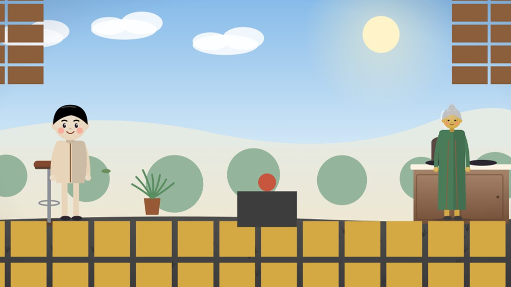
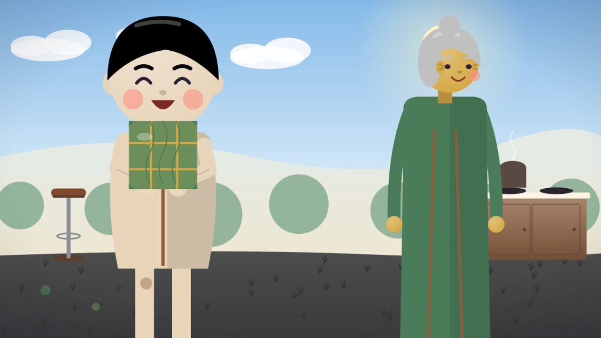

# By-eye checklist · v2-banh-chung

Project `cmv6g4r9e005f2ao49hjkdcry` · run `cmv6ul9yo00002ao09enx017d` · server commit `88c9ce7`. Hero object: #banh-chung.

Look at every frame at full size. Tick each box `[x]` when it holds, or mark it `[!]` and say why on the shot's note line. The film is published only when every box is `[x]` and the verdict is PASS.

## Critic scores (not a measured gate)

- shot(s) scored below 4: 10 (3)

The owner and QC may approve the film past these by eye (owner decision 2026-10-11): replace `none` with `APPROVED by owner <name> and QC <name>`. A by-eye approval never overrides a measured gate.

Critic override: APPROVED by owner Nguyễn Văn Sơn and QC Claude

## Key-object recognition (a model's judgement, not a measured gate)

What the viewer (the vision model) said, with no story, about each drawing of the key object alone:

- #banh-chung: NOT recognised — the viewer said "green grid pattern"

The owner and QC may approve the key object past this by eye (owner decision 2026-10-12, D77): replace `none` with `APPROVED by owner <name> and QC <name>`. A by-eye approval never overrides a measured gate.

Recognition override: APPROVED by owner Nguyễn Văn Sơn and QC Claude

## Shot 1

Beat: Chiều Ba Mươi Tết, bé An cùng bà gói bánh chưng trong sân nhà ở phố cổ Hà Nội.

Measured: Wide shot · cast #courtyard #an #grandma · critic 7/10 · plan: Wide shot of the Hanoi tube house courtyard in golden afternoon light. Bé An and Bà stand near the charcoal stove, low stools and big iron pot visible, brick walls and tiled floor. An holds a dong lea

- [x] no character cropped
- [x] readable (not too dark)
- [x] hero object visible
- [x] story beat present
- [x] key action reads

Note: QC by eye: OK — courtyard in afternoon light, An and Bà by the stove. The bánh chưng is not in this shot's plan (hero box = n/a, ticked).

## Shot 2

Beat: Bà trải lá dong xanh lên mâm, đong gạo nếp trắng, nhân đậu xanh và thịt.

Measured: Medium shot · cast #courtyard #grandma · critic 7/10 · plan: Medium shot, close on Bà's hands spreading glossy green dong leaves on a woven mat, white glutinous rice, mung bean filling and pork laid out. Afternoon light filters through courtyard bricks.

- [x] no character cropped
- [x] readable (not too dark)
- [x] hero object visible
- [x] story beat present
- [x] key action reads

Note: QC by eye: OK — Bà spreads the leaves on a wide tray (reads as a tray, a little stiff). Redone (D86 note).

## Shot 3

Beat: An học bà gấp lá thật vuông và buộc lạt tre thật chặt.

Measured: Medium shot · cast #courtyard #an #grandma #banh-chung · critic 7/10 · plan: Over-the-shoulder two-shot from behind An as Bà guides her small hands folding the dong leaves into a perfect square and tying four pale bamboo strings in a tight grid. The courtyard afternoon light s

- [x] no character cropped
- [x] readable (not too dark)
- [x] hero object visible
- [x] story beat present
- [x] key action reads

Note: QC by eye: OK — Bà and An side by side, An holds the folded parcel. Redone (D86 note).

## Shot 4

Beat: Chiếc bánh đầu tiên An tự gói, bà khen vuông vắn như bánh của người lớn.

Measured: Close-up · cast #courtyard #an #grandma #banh-chung · critic 7/10 · plan: Close-up on the finished square bánh chưng resting in An's cupped palms, leaf veins and bamboo grid sharp. Bà leans in, smiling proudly, afternoon glow on their faces.

- [x] no character cropped
- [x] readable (not too dark)
- [x] hero object visible
- [x] story beat present
- [x] key action reads

Note: QC by eye: OK — the finished parcel big in An's hands, Bà beside her. Redone (D86 note).

## Shot 5

Beat: Đêm xuống, nồi bánh sôi lục bục trên bếp lửa hồng giữa sân.

Measured: Wide shot · cast #courtyard #an #grandma #banh-chung · critic 7/10 · plan: Wide shot of the courtyard at night, charcoal stove glowing red, big iron pot bubbling with steam. An and Bà sit on low stools beside the fire, the wrapped bánh chưng parcels visible on a stool nearby

- [x] no character cropped
- [x] readable (not too dark)
- [x] hero object visible
- [x] story beat present
- [x] key action reads

Note: QC by eye: OK — night, the pot on the fire, the parcel visible, both on stools.

## Shot 6

Beat: Hai bà cháu ngồi canh nồi bánh, bà kể chuyện Lang Liêu dâng bánh cho vua Hùng.

Measured: Medium shot · cast #courtyard #an #grandma #banh-chung · critic 5/10 · critic's action note: The key object (square parcel) is not clearly shown. · plan: Medium two-shot, An and Bà side by side on stools watching the pot, Bà gestures toward the square parcel as she tells the legend of Lang Liêu. Night deepens, firelight dances on their faces.

- [x] no character cropped
- [x] readable (not too dark)
- [x] hero object visible
- [x] story beat present
- [x] key action reads

Note: QC by eye: OK — critic 5 ("key object not clearly shown"), but by eye An holds the parcel in front of her; Bà gestures.

## Shot 7

Beat: Bà chỉ chiếc bánh vuông như mặt đất, An tròn mắt lắng nghe.

Measured: Close-up · cast #courtyard #an #grandma #banh-chung · critic 6/10 · critic's action note: grandma's foot extends beyond frame · plan: Close-up on Bà's finger pointing at the square bánh chưng on the stool, An's round eyes wide with wonder, firelight reflecting. Night, intimate.

- [x] no character cropped
- [x] readable (not too dark)
- [x] hero object visible
- [x] story beat present
- [x] key action reads

Note: QC by eye: OK — Bà points at the parcel on the stool, An listens (close-up crops Bà at the bottom: framing, not a cut head).

## Shot 8

Beat: Đêm giao thừa, pháo hoa nở rực trên những mái ngói phố cổ.

Measured: Wide shot · cast #rooftops #an #grandma · critic 8/10 · plan: Wide shot of Hanoi old quarter rooftops under midnight sky, fireworks blooming in vivid reds and golds over terracotta tiles. An and Bà silhouetted on a rooftop, watching.

- [x] no character cropped
- [x] readable (not too dark)
- [x] hero object visible
- [x] story beat present
- [x] key action reads

Note: QC by eye: OK — fireworks over the rooftops, both small on the roof. The bánh chưng is not in this shot's plan (n/a, ticked).

## Shot 9

Beat: An ngủ gục trên vai bà, tay vẫn nắm sợi lạt tre.

Measured: Close-up · cast #rooftops #an #grandma #banh-chung · critic 6/10 · critic's action note: Bánh chưng appears too large and mispositioned, not clearly visible as a small held prop · plan: Close-up on An asleep on Bà's lap, her small fingers still curled around a pale bamboo string from the bánh chưng. Fireworks glow softly on their faces, midnight.

- [x] no character cropped
- [x] readable (not too dark)
- [x] hero object visible
- [x] story beat present
- [x] key action reads

Note: QC by eye: OK — An asleep leaning on Bà, same scale, the parcel beside them. Redone (QC note).

## Shot 10

Beat: Sáng mùng Một, An mở mắt và chạy ra phòng khách.

Measured: Low angle · cast #front-room #an · critic 3/10 · plan: Medium shot from low angle in the front room at dawn, An darts across wooden floor toward the small wooden table centered under the ancestor altar wall. Dawn light paints the room gold.

- [x] no character cropped
- [x] readable (not too dark)
- [x] hero object visible
- [x] story beat present
- [x] key action reads

Note: QC by eye: OK — An runs into the front room at dawn (critic 3 → Critic override below). The bánh chưng is not in this shot (n/a, ticked). Redone (D87: the walker had been lost).

## Shot 11

Beat: Trên bàn là chiếc bánh chưng vuông vức đầu tiên do chính tay An gói.

Measured: Close-up · cast #front-room #banh-chung · critic 7/10 · plan: Close-up detail shot of the square bánh chưng sitting on the small wooden table in the front room, leaf veins and bamboo grid perfectly clear in morning light. The ancestor altar wall behind, no altar

- [x] no character cropped
- [x] readable (not too dark)
- [x] hero object visible
- [x] story beat present
- [x] key action reads

Note: QC by eye: OK — the bánh chưng on the small wooden table (D80), day-lit; the line says "Trên bàn…".

## Verdict

Reviewer: owner Nguyễn Văn Sơn + QC Claude (QC by eye, every frame at full size; owner sign-off 2026-10-13)

Verdict: PASS (Reviewer: owner Nguyễn Văn Sơn + QC Claude)
