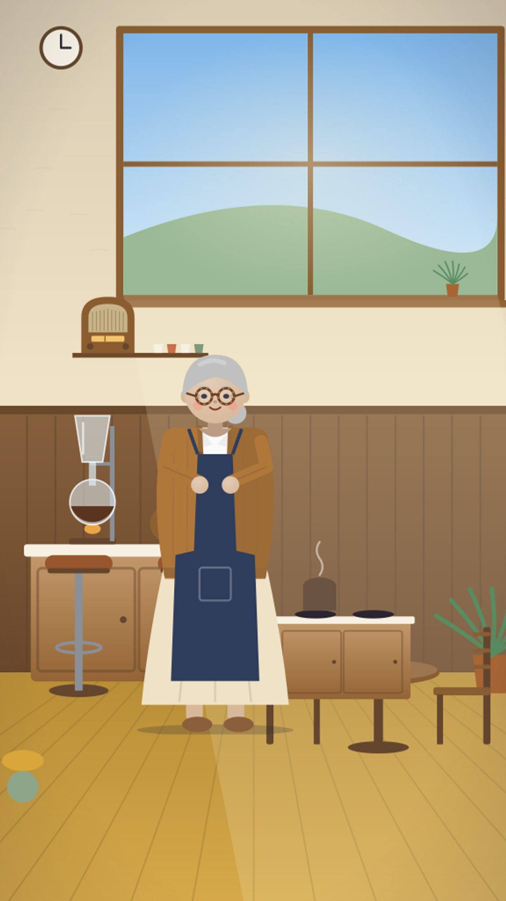
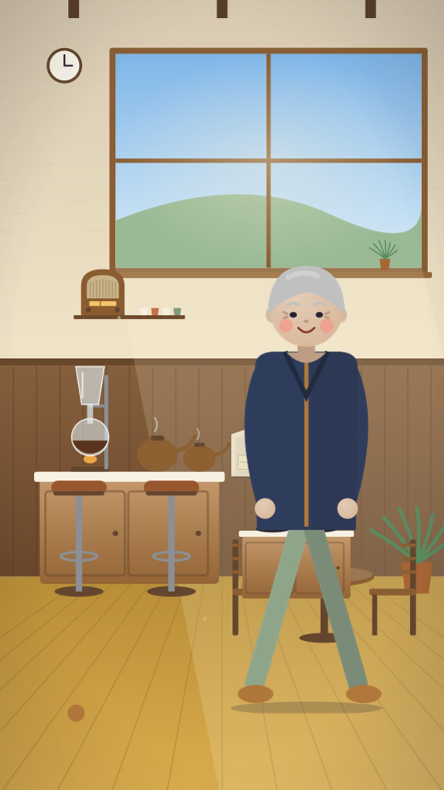
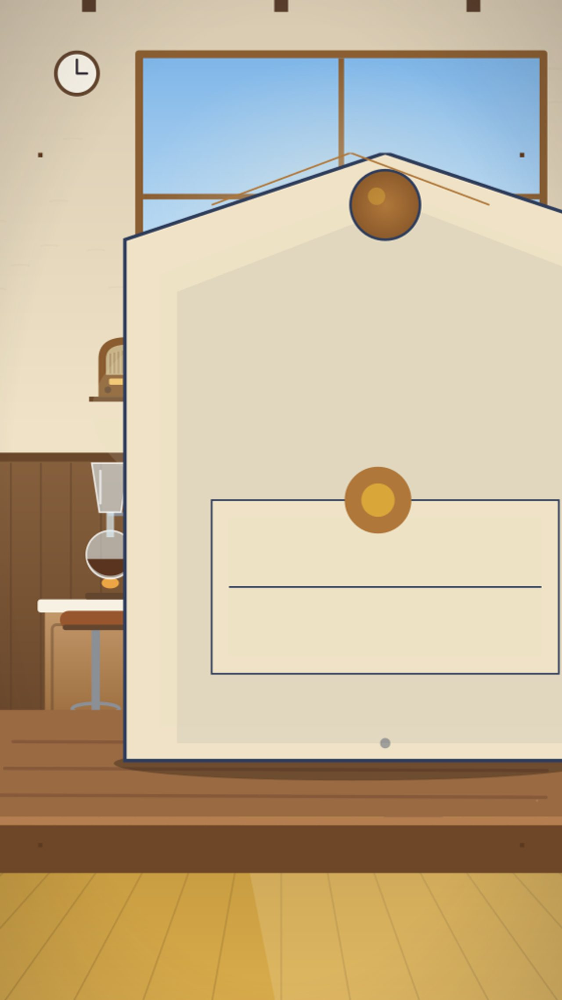
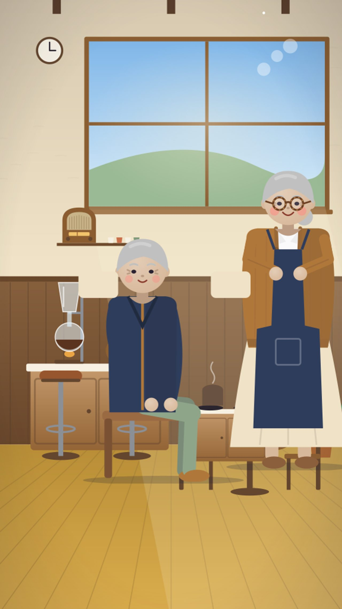
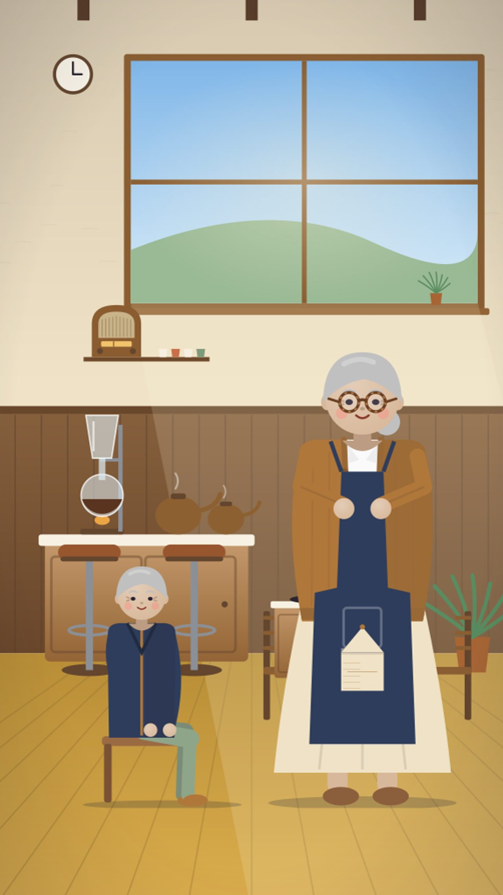
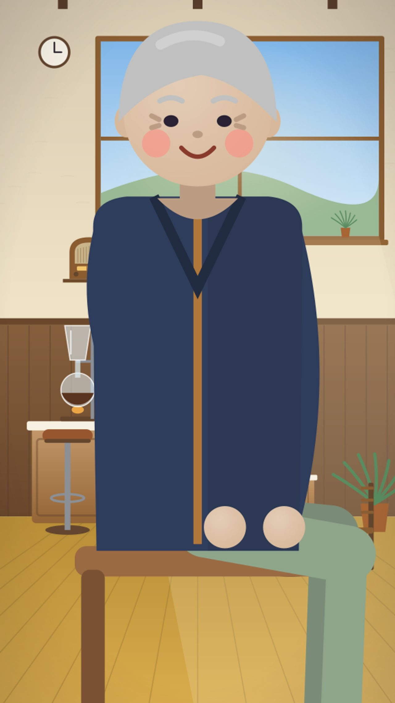

# By-eye checklist · v2-tegami

Project `cmv6gh0ay00a42ao45fxmyd5c` · run `cmv6twvsf003s2as8udur27q4` · server commit `91419fa`. Hero object: #envelope.

Look at every frame at full size. Tick each box `[x]` when it holds, or mark it `[!]` and say why on the shot's note line. The film is published only when every box is `[x]` and the verdict is PASS.

## Critic scores (not a measured gate)

- mean critic score 5.43 < 5.5
- shot(s) scored below 4: 5 (3), 6 (3)

The owner and QC may approve the film past these by eye (owner decision 2026-10-11): replace `none` with `APPROVED by owner <name> and QC <name>`. A by-eye approval never overrides a measured gate.

Critic override: none

## Key-object recognition (a model's judgement, not a measured gate)

What the viewer (the vision model) said, with no story, about each drawing of the key object alone:

- #envelope: NOT recognised — the viewer said "tag"
- #envelope--open: NOT recognised — the viewer said "notebook page"

The owner and QC may approve the key object past this by eye (owner decision 2026-10-12, D77): replace `none` with `APPROVED by owner <name> and QC <name>`. A by-eye approval never overrides a measured gate.

Recognition override: none

## Shot 1

Beat: 春の午後、喫茶ひだまりの窓から、やわらかな日が差しこみます。

Measured: Wide shot · cast #kissaten #haru · critic 8/10 · plan: The kissaten interior basks in spring afternoon light. Warm sunbeams stream through the large window onto the wooden counter, teapots, and potted plants. Cream walls glow amber. Haru-san stands behind

- [ ] no character cropped
- [ ] readable (not too dark)
- [ ] hero object visible
- [ ] story beat present
- [ ] key action reads

Note: 

## Shot 2

Beat: カランと扉が鳴って、古い封筒を手にした、老紳士が入ってきました。

Measured: Medium shot · cast #kissaten #elderly-gentleman #envelope · critic 7/10 · plan: The wooden door slides open with a gentle 'karan' chime. The elderly gentleman steps inside, stooped slightly, dark navy coat catching the light. He clutches the yellowed envelope in both hands, eyes 

- [ ] no character cropped
- [ ] readable (not too dark)
- [ ] hero object visible
- [ ] story beat present
- [ ] key action reads

Note: 

## Shot 3

Beat: 五十年前、好きだった人に、出せなかった手紙だといいます。

Measured: Close-up · cast #kissaten #envelope · critic 6/10 · critic's action note: Seal detail missing · plan: Insert shot: the envelope rests on the wooden counter, its frayed corners and dark amber wax stamp catching the afternoon sun. Dust motes drift in the beam. The seal is intact, fifty years of silence 

- [ ] no character cropped
- [ ] readable (not too dark)
- [ ] hero object visible
- [ ] story beat present
- [ ] key action reads

Note: 

## Shot 4

Beat: ハルさんは、桜の香りの紅茶を淹れて、黙って、となりに座りました。

Measured: Medium shot · cast #kissaten #haru #elderly-gentleman · critic 4/10 · critic's action note: action mismatch · plan: Over-the-shoulder from behind Haru-san as she pours cherry-blossom tea from a ceramic pot into two cups. Steam curls. She sets the pot down, turns, and sits on the stool beside the gentleman. Two-shot

- [ ] no character cropped
- [ ] readable (not too dark)
- [ ] hero object visible
- [ ] story beat present
- [ ] key action reads

Note: 

## Shot 5

Beat: 老紳士は、手紙を、声に出して読みはじめました。読み終えると、小さく、笑いました。

Measured: Medium shot · cast #kissaten #elderly-gentleman #haru #envelope · critic 3/10 · critic's action note: The envelope is not clearly visible and the lighting lacks amber depth. · plan: The gentleman lifts the envelope, breaks the wax seal, and unfolds the letter. He reads aloud, voice low. Haru listens, hands on her cup. Light slants lower, amber deepening. He finishes, refolds, and

- [ ] no character cropped
- [ ] readable (not too dark)
- [ ] hero object visible
- [ ] story beat present
- [ ] key action reads

Note: 

## Shot 6

Beat: 「やっと、言えた気がします」。

Measured: Close-up · cast #elderly-gentleman #kissaten · critic 3/10 · critic's action note: face not fully visible · plan: Tight on the gentleman's face, afternoon light gilding his cheekbones. Eyes glisten, smile lines deepen. He whispers the line to himself, shoulders dropping a lifetime's weight.

- [ ] no character cropped
- [ ] readable (not too dark)
- [ ] hero object visible
- [ ] story beat present
- [ ] key action reads

Note: 

## Shot 7

Beat: 帰り道、川沿いの桜が、ひとひら、封筒の上に落ちました。

Measured: Wide shot · cast #river-path #elderly-gentleman #envelope · critic 7/10 · plan: Evening on the river path. Cherry trees in full bloom canopy the walkway, petals sailing on the breeze. The gentleman walks away from us, envelope in hand. A single petal spirals down and lands on the

- [ ] no character cropped
- [ ] readable (not too dark)
- [ ] hero object visible
- [ ] story beat present
- [ ] key action reads

Note: 

## Verdict

Reviewer: 

Verdict: PENDING (write PASS or FAIL)
